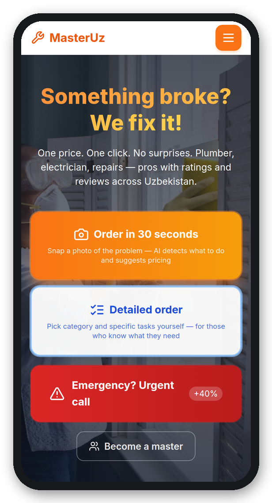
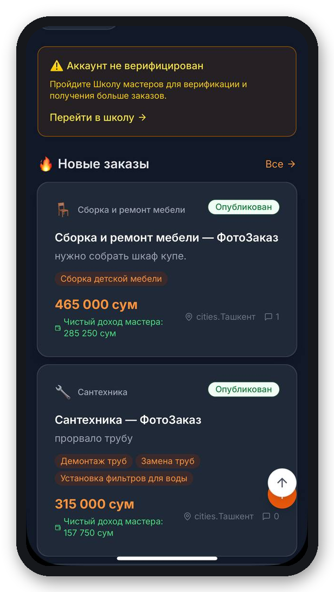
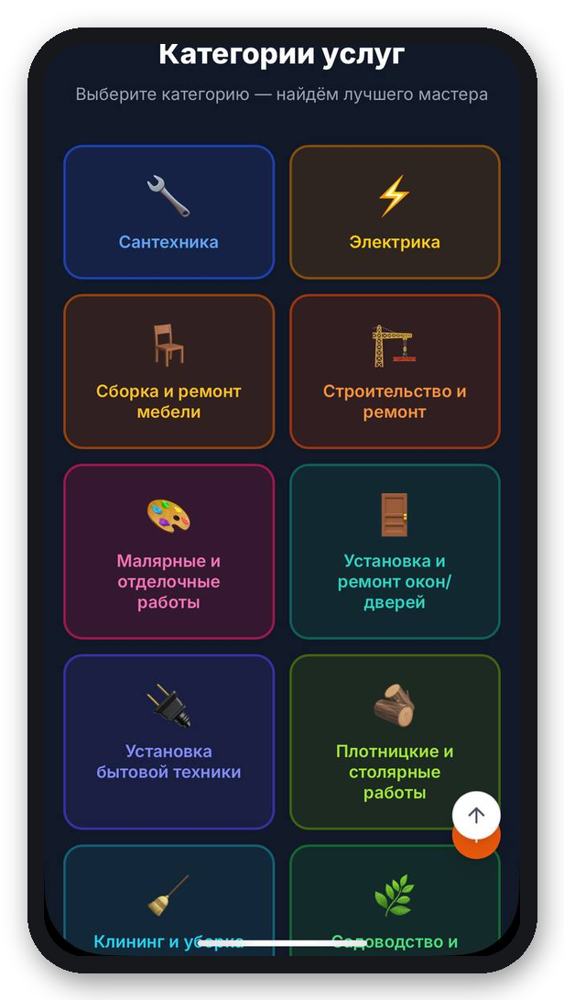
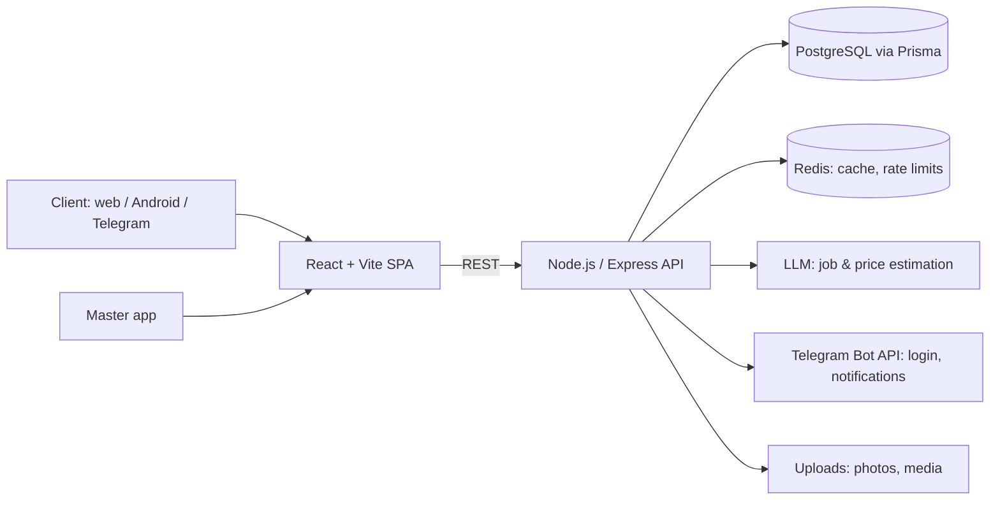

# MasterUz — AI-powered home services marketplace

**Live:** [www.mestro.uz](https://www.mestro.uz) · Web + Android · RU / UZ / EN

MasterUz connects clients with plumbers, electricians, furniture assemblers and other home-service masters across Uzbekistan. The client describes the problem with a photo or a few words — **AI estimates the job and the price** — and nearby masters respond. I designed, built and run the whole product.

  
  
  

## Key features

- **Order in 30 seconds** — photo or voice → AI detects the task and suggests a price from a curated price list.
- **Transparent pricing** — the master checks the AI estimate; if there is more work, they propose a new price and the client confirms it.
- **Masters near you** — order feed with the AI price and the master's net income, reviews and ratings, warranty set by the master (5–365 days).
- **Telegram login & chat**, Android app (Capacitor), three languages.
- **Masters' School** — onboarding courses and verification before masters get orders.
- **Admin dashboard** with traffic-source (UTM) analytics and daily counters.
- **Automated content** — daily bilingual promo videos rendered and published on schedule.

## Architecture

## Engineering highlights

- **AI price estimation with guardrails** — the model maps a free-form request to catalog tasks; prices come from a verified market price list, so the AI can't invent numbers. Evaluated against real Tashkent prices.
- **Privacy by design** — the client's address is revealed only to the chosen master; API responses are shaped per viewer (no over-fetching of user data); uploaded media is accepted only from the platform's own storage.
- **Database changes only via migrations**, applied automatically on deploy; destructive changes reviewed separately.
- **Mobile-first** UI checked at 360–375 px; RU/UZ/EN for every new string.
- **Tests:** Vitest unit tests and Playwright end-to-end flows run before every release.

## Stack

React · TypeScript · Vite · Tailwind CSS · Node.js · Express · Prisma · PostgreSQL · Redis · Capacitor (Android) · Telegram Bot API · LLM APIs · Railway · Vitest · Playwright

---
Source code is private (commercial product). Built and maintained by [Vladimir Glukhov](https://www.linkedin.com/in/vladimir-glukhov-dev).
